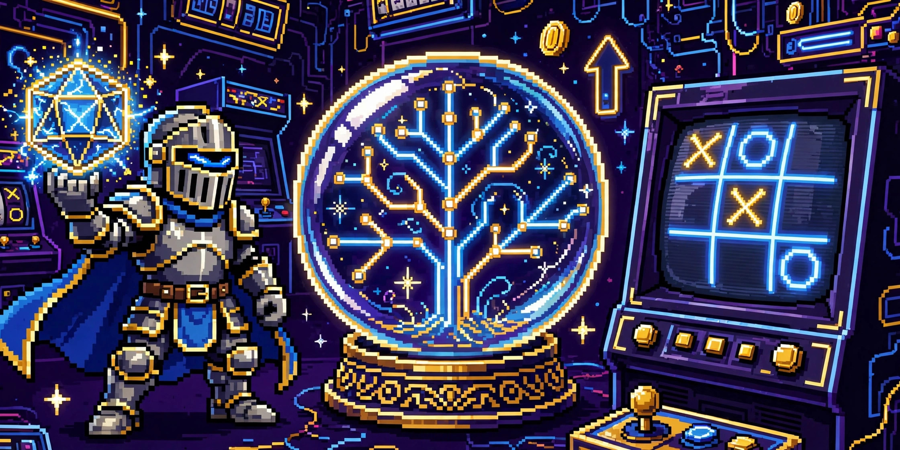

## 🙋 About me

- 🎓 BSc Computer Science (Honours), Nipissing University
- 🎮 Game Design & Simulation student @ Cambrian College
- 🤖 I build AI-powered apps, web games, and automation pipelines
- 🌱 Currently exploring: game dev, LLMs, and shipping something new every week
- ⚡ Philosophy: if it's not loud, flashy, and fun — ship it again

## 🛠️ Tech stack

### Currently vibing with

## 🚀 Featured projects

| Project | What it is |
|---|---|
| [🎲 AI Dungeon Master](https://github.com/vivekn4/ai-dungeon-master) | A full D&D campaign in your browser, narrated by AI — infinite adventures, zero cost. Now with synthesized SFX & canvas VFX |
| [🔮 What-If Simulator](https://github.com/vivekn4/what-if-simulator) | Type any life decision, get your next 10 years written back as a story — with branching timelines, SFX & VFX |
| [💚 Arogya](https://github.com/vivekn4/arogya) | AI wellness companion — live web app with chat, moods, and habits |

## 📊 GitHub stats

## 🏆 Trophies

## 🐍 Watch my contributions get eaten

<picture>
  <source media="(prefers-color-scheme: dark)" srcset="https://raw.githubusercontent.com/vivekn4/vivekn4/output/github-snake-dark.svg" />
  <source media="(prefers-color-scheme: light)" srcset="https://raw.githubusercontent.com/vivekn4/vivekn4/output/github-snake.svg" />
  
</picture>

## 🎮 Play Tic-Tac-Toe with me — right here on my profile

**How to play:**

1. Go to the pinned [🎮 Tic-Tac-Toe issue](https://github.com/vivekn4/vivekn4/issues) (pinned at the top of the issues tab)
2. Comment a cell like `B2` — you play **X** (blue)
3. A built-in minimax AI plays **O** (red) — it plays perfectly, so good luck beating it
4. Comment `new` anytime for a fresh game

Columns are A–C, rows are 1–3. A GitHub Action processes your move and replies with the updated board within seconds. No sign-ups, no servers — just issues, Python, and SVG. 🤖

---

⭐️ *Like what you see? Star a repo — it genuinely helps!*

---

**Crafted by [Vivek Nair](https://github.com/vivekn4) · VN**

